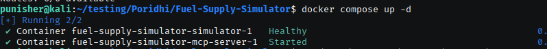
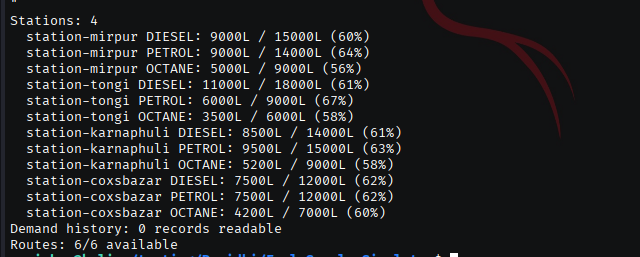

# Day 2 - Nov 23

## Theme: Claude Agents - Monitor, Forecast, Allocate

---

Started setting up the agents layer today. Created the agents/ directory with three subfolders for each agent and built the main orchestrator first since everything else hangs off it. The orchestrator runs the core loop — Observe, Detect, Predict, Decide, Act, Monitor, Recover — and calls each agent in sequence. If anything fails mid-cycle it waits and retries instead of crashing.

After that built the monitoring agent. It reads inventory across all 4 stations for all 3 fuel types and raises a shortage alert whenever a station's fill ratio drops below 25% of capacity. It also pulls whatever active crisis events are running at that moment so the alert carries that context forward to the next agent.

Files added so far:
```
agents/orchestrator.py
agents/monitor/__init__.py
agents/monitor/agent.py
agents/forecaster/__init__.py
agents/allocator/__init__.py
```

Then built the forecasting agent. It takes the alerts from the monitoring agent, pulls the last 12 simulated hours of demand history for that station and fuel type, averages it out per tick, and divides the current inventory by that rate to get hours remaining before stockout. Results come back sorted by urgency — most critical first. Risk levels are CRITICAL under 3 hours, HIGH under 8, MEDIUM under 24, LOW after that.

Files added:
```
agents/forecaster/agent.py
```

Then the allocation agent. It takes the CRITICAL and HIGH forecasts, finds the fastest available route to that station, checks the depot actually has stock, works out a safe quantity to send — capped at half the depot stock, the route max shipment, and the depot dispatch limit — and submits it to the simulator. Every decision it makes comes with a plain-English explanation of why: current inventory, demand rate, hours remaining, where it is sending from, and how long the transit takes. That explanation is what shows up on the dashboard later.

Files added:
```
agents/allocator/agent.py
```

Wrapped up the day by adding requirements.txt and a Dockerfile for the agents layer so it runs in the same docker network as everything else.

---

## Summary

- Orchestrator built with the full Observe, Detect, Predict, Decide, Act, Monitor, Recover loop
- Monitoring agent reads all stations and raises alerts when fill ratio drops below 25%
- Forecasting agent calculates hours to stockout from real demand history, sorts by urgency
- Allocation agent picks the fastest available route, works out a safe quantity, submits to simulator, and writes a plain-English explanation for every decision
- All three agents Dockerized and wired together

---

## Test run to see all ok till now

Start the simulator:

```bash
docker compose up -d
```


Trigger the agent loop manually against the live simulator:

```bash
cd /home/punisher/testing/Poridhi/Fuel-Supply-Simulator

python3 -c "
import httpx

client = httpx.Client(base_url='http://localhost:8000', timeout=10.0)

stations = client.get('/v1/stations').json()
print(f'Stations: {len(stations)}')
for s in stations:
    for fuel in ['DIESEL','PETROL','OCTANE']:
        inv = s['inventory'].get(fuel, 0)
        cap = s['capacity'].get(fuel, 1)
        ratio = inv/cap
        print(f'  {s[\"id\"]} {fuel}: {inv}L / {cap}L ({ratio:.0%})')

history = client.get('/v1/demand-history', params={'limit':5}).json()
print(f'Demand history: {len(history)} records readable')

routes = client.get('/v1/routes').json()
available = [r for r in routes if r['status'] == 'AVAILABLE']
print(f'Routes: {len(available)}/{len(routes)} available')
"

```

Results : 



