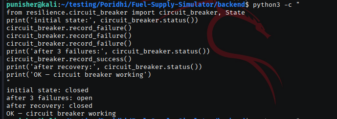
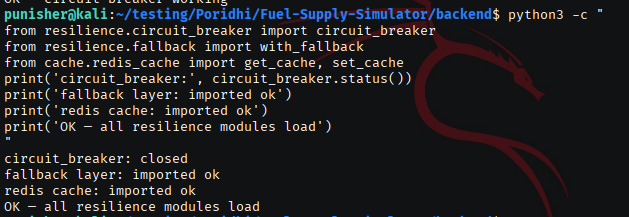
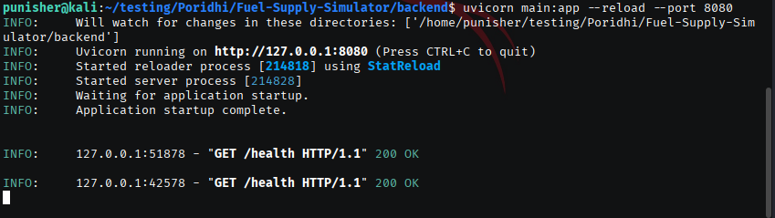
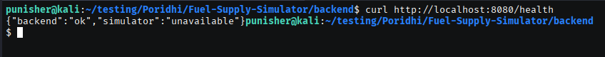

# Day 3 - Nov 24

## Theme: FastAPI Backend + PostgreSQL + Redis

---

Started the backend today. This is the layer that sits between the agents and the dashboard — the agents write their decisions here, the dashboard reads from here. Created the full folder structure: api, db, cache, resilience, simulator. Built the FastAPI app entry point in main.py and wired up all the routers so the structure is clear before filling each one in.

Files added:
```
backend/main.py
backend/api/__init__.py
backend/db/__init__.py
backend/cache/__init__.py
backend/resilience/__init__.py
backend/simulator/__init__.py
```

Then built the simulator client in backend/simulator/client.py. It wraps every call to the BUP simulator with retry logic — if a request fails it waits and tries again up to 3 times with increasing delay. If the simulator returns 503 it raises SimulatorUnavailable so the resilience layer above it knows to switch to cached data instead of crashing.

Files added:
```
backend/simulator/client.py
```

After that built all the API routes. Stations and depots call the simulator client directly and pass the response through. Events and metrics do the same. Alerts and decisions read from PostgreSQL — those are written by the agents, not fetched live. Health checks both the backend itself and whether the simulator is reachable.

Files added:
```
backend/api/stations.py
backend/api/depots.py
backend/api/events.py
backend/api/metrics.py
backend/api/alerts.py
backend/api/decisions.py
backend/api/health.py
```

Then the Redis cache layer. Any time the simulator client successfully returns data it gets written to Redis with a 5 minute TTL. If the simulator goes down and returns 503, the resilience layer reads from Redis instead so the dashboard never sees an outage unless the cache is also expired.

Files added:
```
backend/cache/redis_cache.py
```

Built the circuit breaker in backend/resilience/circuit_breaker.py. It tracks consecutive simulator failures — after 3 in a row it opens the circuit and the system stops trying to reach the simulator entirely. After 30 seconds it moves to half-open and tries once more. If that works it closes again. This is what lets the system stay alive under fault injection.

Files added:
```
backend/resilience/circuit_breaker.py
```

Last thing for the day was the fallback layer in backend/resilience/fallback.py. Every API route wraps its simulator call through with_fallback() — it checks the circuit breaker first, and if it is open serves Redis cache. If the circuit is closed but the call fails it records the failure, tries Redis, and only raises an error if the cache is also empty. This is the layer that keeps the dashboard alive when the simulator is injecting faults.

Files added:
```
backend/resilience/fallback.py
```

---

## Summary

- FastAPI app with full router structure
- PostgreSQL models for decisions and alerts with SQLAlchemy
- Simulator client with 3-attempt retry and exponential backoff
- API routes for stations, depots, events, metrics, alerts, decisions, health
- Redis cache storing last known simulator state with 5 minute TTL
- Circuit breaker opening after 3 consecutive failures, recovering after 30 seconds
- Fallback layer wrapping every simulator call so the dashboard stays alive under fault injection
- Backend Dockerized and ready to wire into docker-compose

---

## Test Run

**circuit breaker state transitions:**

```bash
cd /home/punisher/testing/Poridhi/Fuel-Supply-Simulator/backend
python3 -c "
from resilience.circuit_breaker import circuit_breaker, State
print('initial state:', circuit_breaker.status())
circuit_breaker.record_failure()
circuit_breaker.record_failure()
circuit_breaker.record_failure()
print('after 3 failures:', circuit_breaker.status())
circuit_breaker.record_success()
print('after recovery:', circuit_breaker.status())
print('OK — circuit breaker working')
"
```

Output:

**resilience modules:**

```bash
cd /home/punisher/testing/Poridhi/Fuel-Supply-Simulator/backend
python3 -c "
from resilience.circuit_breaker import circuit_breaker
from resilience.fallback import with_fallback
from cache.redis_cache import get_cache, set_cache
print('circuit_breaker:', circuit_breaker.status())
print('fallback layer: imported ok')
print('redis cache: imported ok')
print('OK — all resilience modules load')
"
```

Output:


**backend and the health endpoint:**

```bash
cd /home/punisher/testing/Poridhi/Fuel-Supply-Simulator/backend
uvicorn main:app --reload --port 8080
```


In a second terminal:

```bash
curl http://localhost:8080/health
```

Output:



`"simulator":"unavailable"` is not a failure — it proves the backend handles a missing simulator gracefully instead of crashing. The resilience layer catches the connection error and reports degraded mode instead of a 500. This is exactly what the circuit breaker and fallback layer are built to do.

