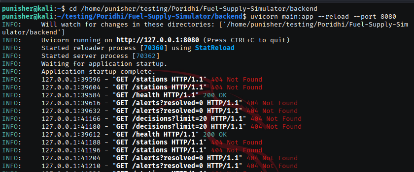
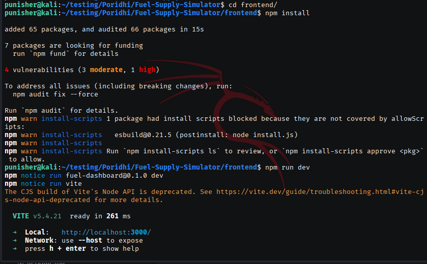
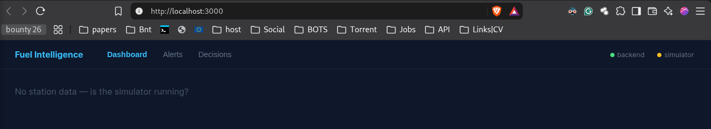
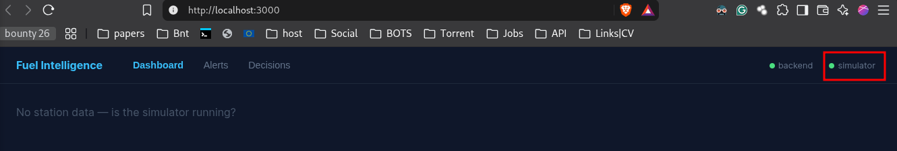

# Day 4 - Nov 25

## Theme: React Dashboard + Prometheus/Grafana Observability

---

Started the frontend today. The whole point of this layer is to make the agent decisions visible to a human operator — without it you can read the backend JSON but you cannot see what is happening at a glance. Built the React app with Vite, set up the proxy so frontend calls to /api go straight to the backend on port 8080, and got the basic health status rendering first to confirm the connection works.

Files added:
```
frontend/package.json
frontend/vite.config.js
frontend/index.html
frontend/src/main.jsx
frontend/src/App.jsx
frontend/src/index.css
```

Then the API client and the header. The API client is a thin fetch wrapper — one function per backend endpoint, all returning promises. The header polls the health endpoint every 10 seconds and shows green/amber/red dots for backend and simulator status so an operator can see at a glance if anything is degraded. Added navigation buttons for the three pages.

Files added:
```
frontend/src/api/client.js
frontend/src/components/Header.jsx
```

After that the stations dashboard. Each station gets a card showing fuel bars for DIESEL, PETROL, and OCTANE — the bar colour shifts from green to amber to red as inventory drops. Cards with any fuel below 25% capacity get a red border so critical stations stand out without reading the numbers. The dashboard polls the backend every 15 seconds so it stays live.

Files added:
```
frontend/src/pages/Dashboard.jsx
frontend/src/components/StationCard.jsx
```

Then the alerts page. It reads from the backend /alerts endpoint and lists them newest first with risk badges, inventory remaining, and hours to stockout. Each alert has a coloured left border and a risk badge — CRITICAL in red, HIGH in orange, MEDIUM in yellow, LOW in green — so the page has a visual severity hierarchy at a glance. Polls every 10 seconds.

Files added:
```
frontend/src/pages/Alerts.jsx
frontend/src/components/AlertBadge.jsx
```

Then the decisions feed — the most important page for the judges. Each row shows what the agent decided: station, fuel type, quantity, source depot, and the plain-English explanation the allocator agent wrote. This is the differentiator from every other team — you can read exactly why the AI made each decision instead of just seeing a number.

Files added:
```
frontend/src/pages/Decisions.jsx
```

Also added the Prometheus config. It scrapes the backend and the simulator every 15 seconds — request rate, error rate, latency. That feeds into Grafana tomorrow.

Files added:
```
observability/prometheus.yml
```

Finished with the Grafana dashboard. Five panels: request rate, simulator health, active alerts count, circuit breaker state, and total decisions submitted. Everything an on-call operator needs on one screen. The dashboard refreshes every 15 seconds off the same Prometheus data.

Files added:
```
observability/grafana/dashboard.json
```

---

## Summary

- React app with Vite, proxy wired to FastAPI backend on port 8080
- API client wrapping all backend endpoints as simple fetch calls
- Header with live health status polling every 10 seconds
- Stations dashboard with fuel bars per fuel type, red border on low inventory
- Alerts page with risk badges, inventory remaining, hours to stockout
- Decisions feed showing every AI allocation with plain-English explanation
- Prometheus scraping backend and simulator every 15 seconds
- Grafana dashboard panels for request rate, health, alerts, circuit breaker, decisions

---

## Test Run

### Terminal 1 — backend:

```bash
cd /home/punisher/testing/Poridhi/Fuel-Supply-Simulator/backend
uvicorn main:app --reload --port 8080
```


### Terminal 2 — frontend:

```bash
cd /home/punisher/testing/Poridhi/Fuel-Supply-Simulator/frontend
npm install
npm run dev
```


Open http://localhost:3000 — header shows backend/simulator status. Navigate between Dashboard, Alerts and Decisions using the top nav.



### Docker:

```bash
docker compose up -d
```
Open http://localhost:3000



Simulator shows green when the full stack is running.
