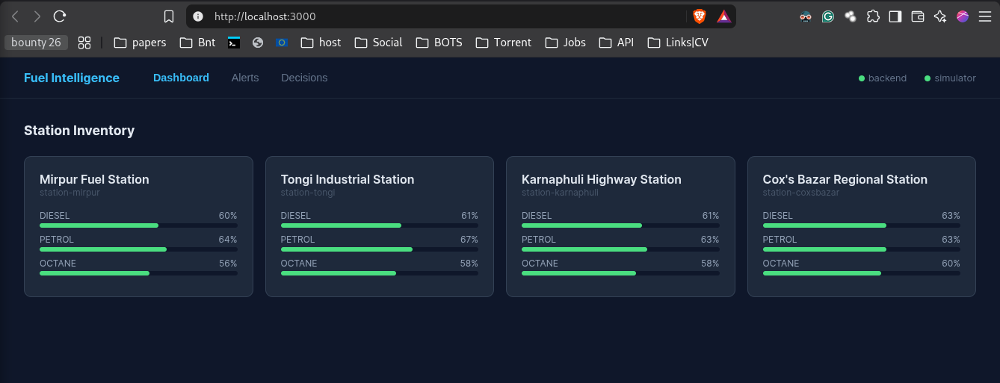

# Day 5 - Nov 26

## Theme: Load Testing + CI/CD + Final Demo Polish

---

Last day before submission. The system is built — MCP server, agents, backend, frontend, observability. Today is about making sure it holds under load, automates its own quality checks, and ships cleanly as a single stack.

Started with the load tests. Built two k6 scripts: a smoke test that sends one user through every endpoint for 30 seconds just to confirm nothing is broken, and a full load test that ramps up to 50 concurrent users and checks that p95 latency stays under 500ms and the error rate stays under 1%. The load test hits health, stations, depots, alerts, decisions, and metrics randomly to simulate a real operator using the dashboard while agents are running in the background.

Files added:
```
devops/k6/smoke-test.js
devops/k6/load-test.js
```

Then the CI pipeline. Three jobs run on every push to main: MCP server smoke tests in Python, a backend import check that confirms all resilience and API modules load cleanly, and a frontend build to catch any broken JSX before it hits production. The MCP tests are the same ones from day 1 — they now run automatically on every commit so regressions are caught immediately.

Files added:
```
.github/workflows/ci.yml
```

Then wired the full stack together in docker-compose.yml. This file existed since day 1 but was hidden from the repo while each service was being built — the simulator and MCP server were the only things uncommented. Today all the services came online: PostgreSQL, Redis, the FastAPI backend, the agents, the React frontend, Prometheus, and Grafana. Everything depends on what it needs and has healthchecks so the startup order is correct. One command brings the entire platform up.

Files updated:
```
docker-compose.yml
```

---

## Summary

- k6 smoke test hitting every endpoint with 1 user for 30 seconds
- k6 load test ramping to 50 concurrent users, p95 < 500ms, error rate < 1%
- GitHub Actions CI with 3 jobs: MCP tests, backend import check, frontend build
- docker-compose.yml fully wired — all 9 services running from one command
- Five days, six layers, one agentic intelligence platform

---

## Run it yourself

```bash
git clone https://github.com/Punih3r7/-Fuel-Supply-Simulator-.git
cd Fuel-Supply-Simulator
docker compose up -d
```

Wait for all services to be healthy, then:

| Service | URL |
|---|---|
| Simulator | http://localhost:8000/v1/health |
| Backend | http://localhost:8080/health |
| Dashboard | http://localhost:3000 |

| Prometheus | http://localhost:9090 |
| Grafana | http://localhost:3001 |

Run the smoke test:

```bash
k6 run devops/k6/smoke-test.js
```

Run the full load test:

```bash
k6 run devops/k6/load-test.js
```
